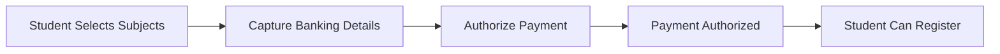
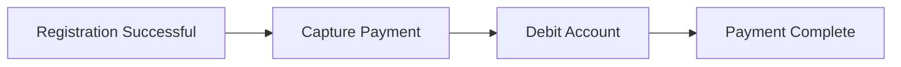
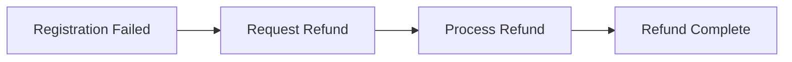

# University Payment System - Backend

A comprehensive backend solution for a WhatsApp-based university registration cycle notification system with delayed payment processing.

## 🚀 Features

### Core Payment System
- **Delayed Payment Flow**: Capture banking details but only debit after successful registration (Uber-style)
- **JWT Authentication**: Secure, stateless authentication for students
- **Encrypted Banking Details**: AES-256-GCM encryption for sensitive data
- **Payment Status Tracking**: Real-time payment status updates
- **Refund Processing**: Automated refund system with notifications

### Registration Management
- **Registration Cycles**: Manage academic year registration periods
- **Fee Management**: Dynamic fee calculation with subject and residence fees
- **Campus & Subject Selection**: Multi-campus support with subject management
- **Residence Applications**: Optional residence application integration

### Notification System
- **WhatsApp Integration**: Automated WhatsApp notifications (placeholder)
- **Email Notifications**: Multi-channel communication
- **Webhook Support**: Real-time payment gateway integration
- **Status Updates**: Automated payment status notifications

### Security & Compliance
- **Data Encryption**: Banking details encrypted at rest
- **Rate Limiting**: API rate limiting for security
- **Input Validation**: Comprehensive request validation
- **Error Handling**: Structured error responses
- **Audit Trail**: Complete transaction logging

## 🛠️ Technology Stack

- **Runtime**: Node.js with TypeScript
- **Framework**: Express.js
- **Database**: MongoDB with Mongoose ODM
- **Authentication**: JWT (JSON Web Tokens)
- **Encryption**: AES-256-GCM
- **Validation**: express-validator
- **Security**: Helmet, CORS, Rate Limiting

## 📦 Installation

1. **Clone the repository**
   ```bash
   git clone <repository-url>
   cd payment-system
   ```

2. **Install dependencies**
   ```bash
   npm install
   ```

3. **Environment Setup**
   ```bash
   cp env.example .env
   ```
   
   Update the `.env` file with your configuration:
   ```env
   MONGODB_URI=mongodb://localhost:27017/university_payment_system
   JWT_SECRET=your-super-secret-jwt-key-here
   JWT_EXPIRES_IN=7d
   PORT=3000
   NODE_ENV=development
   ENCRYPTION_KEY=your-32-character-encryption-key-here
   ```

4. **Start the server**
   ```bash
   # Development
   npm run dev
   
   # Production
   npm run build
   npm start
   ```

## 🔧 API Endpoints

### Authentication
- `POST /api/auth/register` - Student registration
- `POST /api/auth/login` - Student login
- `GET /api/auth/profile` - Get student profile
- `PUT /api/auth/profile` - Update student profile

### Payments
- `POST /api/payments/authorize` - Authorize payment (capture banking details)
- `POST /api/payments/capture/:paymentId` - Capture payment (debit account)
- `POST /api/payments/refund/:paymentId` - Process refund
- `POST /api/payments/cancel/:paymentId` - Cancel payment
- `GET /api/payments/:paymentId` - Get payment details
- `GET /api/payments` - Get student's payments

### Registration
- `GET /api/registration/cycles` - Get active registration cycles
- `GET /api/registration/cycles/:cycleId` - Get specific cycle
- `GET /api/registration/cycles/:cycleId/status` - Get registration status
- `GET /api/registration/cycles/:cycleId/subjects` - Get available subjects
- `POST /api/registration/cycles/:cycleId/calculate-fees` - Calculate fees

### Students
- `GET /api/students/dashboard` - Student dashboard
- `GET /api/students/payments` - Payment history
- `GET /api/students/transactions` - Transaction history
- `GET /api/students/statistics` - Payment statistics

### Webhooks
- `POST /api/webhooks/payment-gateway` - Payment gateway webhooks
- `POST /api/webhooks/whatsapp` - WhatsApp webhooks
- `POST /api/webhooks/registration-cycle` - Registration cycle webhooks

## 💳 Payment Flow

### 1. Authorization Phase


### 2. Capture Phase


### 3. Refund Flow


## 🔐 Security Features

### Data Encryption
- Banking details encrypted using AES-256-GCM
- Encryption keys stored in environment variables
- Secure key derivation using PBKDF2

### Authentication & Authorization
- JWT-based authentication
- Token expiration handling
- Student-specific data access

### API Security
- Rate limiting (100 requests per 15 minutes)
- CORS configuration
- Helmet security headers
- Input validation and sanitization

## 📊 Database Schema

### Student Model
```typescript
{
  studentNumber: string;
  email: string;
  phoneNumber: string;
  firstName: string;
  lastName: string;
  dateOfBirth: Date;
  whatsappNumber?: string;
  isActive: boolean;
}
```

### Payment Model
```typescript
{
  studentId: ObjectId;
  registrationCycleId: ObjectId;
  paymentReference: string;
  status: 'pending' | 'authorized' | 'captured' | 'failed' | 'refunded' | 'cancelled';
  amount: number;
  bankingDetails: EncryptedBankingDetails;
  selectedCampus: string;
  selectedSubjects: SubjectSelection[];
  paymentSummary: PaymentSummary;
}
```

### Transaction Model
```typescript
{
  paymentId: ObjectId;
  studentId: ObjectId;
  type: 'authorization' | 'capture' | 'refund' | 'reversal';
  status: 'pending' | 'success' | 'failed' | 'cancelled';
  amount: number;
  reference: string;
  externalTransactionId?: string;
}
```

## 🔔 Notification System

### WhatsApp Notifications
- Payment status updates
- Registration reminders
- Refund confirmations
- Cycle opening/closing alerts

### Email Notifications
- Backup communication channel
- Detailed payment receipts
- Registration confirmations

### Webhook Integration
- Real-time payment gateway updates
- Automated status synchronization
- External system integration

## 🚀 Deployment

### Environment Variables
```env
# Database
MONGODB_URI=mongodb://localhost:27017/university_payment_system

# JWT
JWT_SECRET=your-super-secret-jwt-key-here
JWT_EXPIRES_IN=7d

# Server
PORT=3000
NODE_ENV=production

# Encryption
ENCRYPTION_KEY=your-32-character-encryption-key-here

# Payment Gateway
PAYMENT_GATEWAY_API_KEY=your-payment-gateway-key
PAYMENT_GATEWAY_SECRET=your-payment-gateway-secret

# WhatsApp Integration
WHATSAPP_API_URL=https://graph.facebook.com/v18.0
WHATSAPP_ACCESS_TOKEN=your-whatsapp-access-token
WHATSAPP_PHONE_NUMBER_ID=your-phone-number-id
```

### Production Considerations
- Use a production MongoDB instance
- Set up proper SSL/TLS certificates
- Configure reverse proxy (nginx)
- Set up monitoring and logging
- Implement backup strategies
- Use environment-specific configurations

## 🧪 Testing

```bash
# Run tests
npm test

# Run with coverage
npm run test:coverage
```

## 📝 API Documentation

### Request/Response Examples

#### Student Registration
```bash
POST /api/auth/register
Content-Type: application/json

{
  "studentNumber": "STU123456",
  "email": "student@university.ac.za",
  "phoneNumber": "+27123456789",
  "firstName": "John",
  "lastName": "Doe",
  "dateOfBirth": "2000-01-01",
  "whatsappNumber": "+27123456789"
}
```

#### Payment Authorization
```bash
POST /api/payments/authorize
Authorization: Bearer <jwt-token>
Content-Type: application/json

{
  "registrationCycleId": "64a1b2c3d4e5f6789012345",
  "selectedCampus": "main-campus",
  "selectedSubjects": [
    {
      "subjectId": "subj-001",
      "subjectCode": "MATH101"
    }
  ],
  "bankingDetails": {
    "accountNumber": "1234567890",
    "accountHolder": "John Doe",
    "bankName": "Standard Bank",
    "branchCode": "051001",
    "accountType": "savings"
  },
  "residenceApplication": {
    "applied": true,
    "residenceType": "on-campus"
  }
}
```

## 🤝 Contributing

1. Fork the repository
2. Create a feature branch
3. Make your changes
4. Add tests if applicable
5. Submit a pull request

## 📄 License

This project is licensed under the MIT License.

## 🆘 Support

For support and questions:
- Create an issue in the repository
- Contact the development team
- Check the documentation

---

**Note**: This is a backend solution focused on the payment system. For the complete WhatsApp-based registration system, you'll need to integrate with WhatsApp Business API and implement the frontend components.


